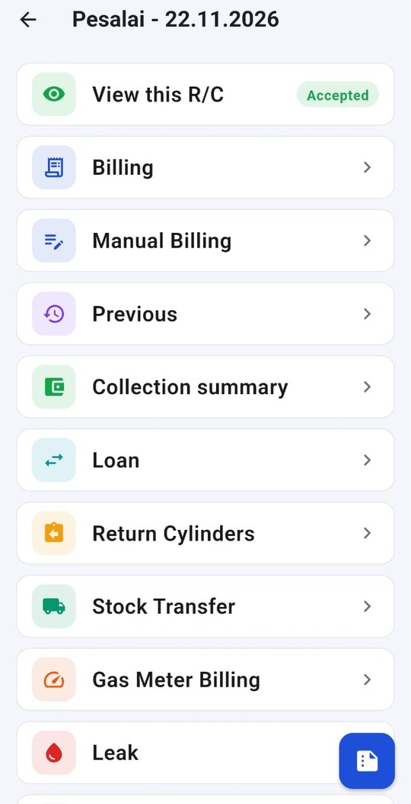
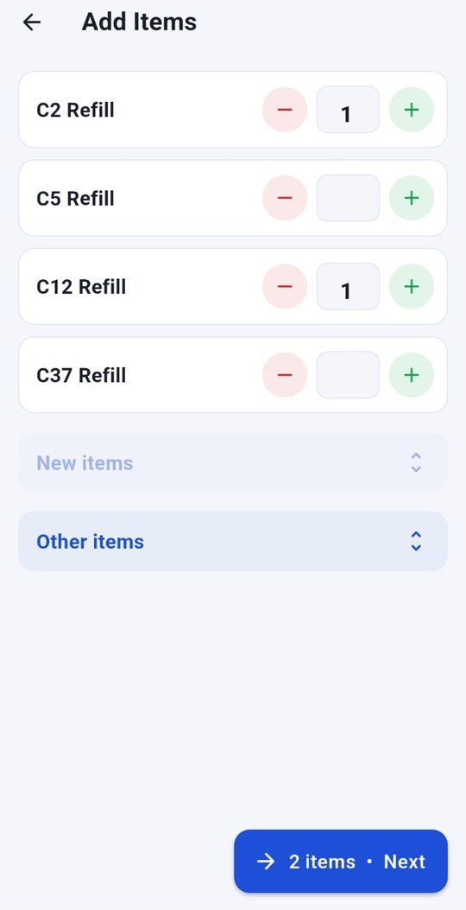
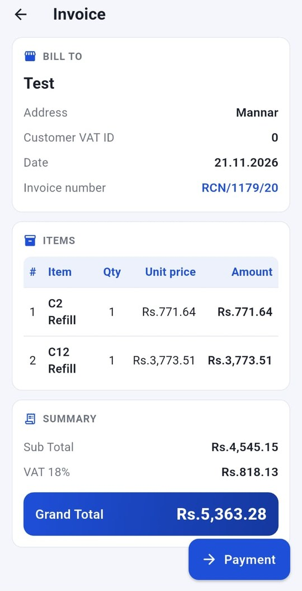
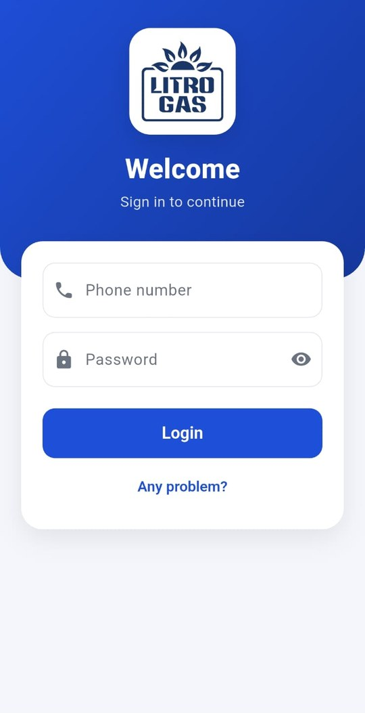
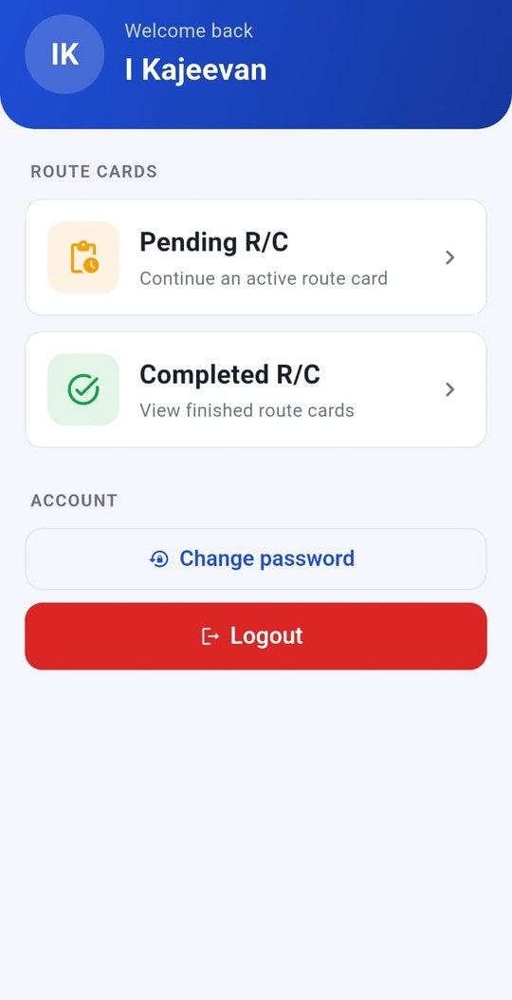
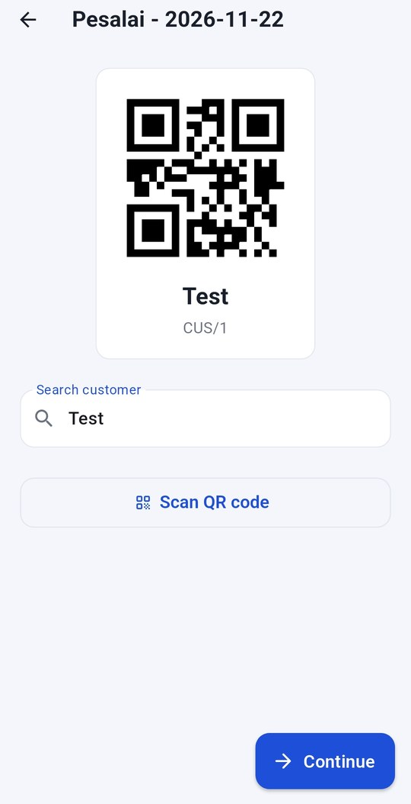
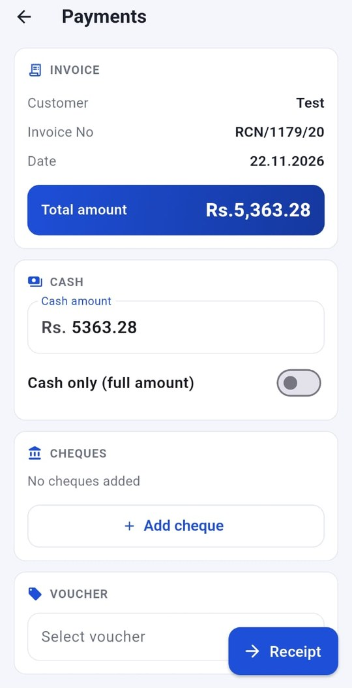
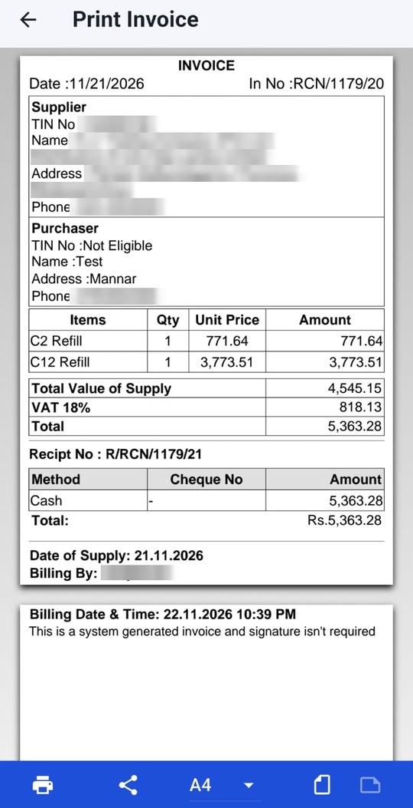
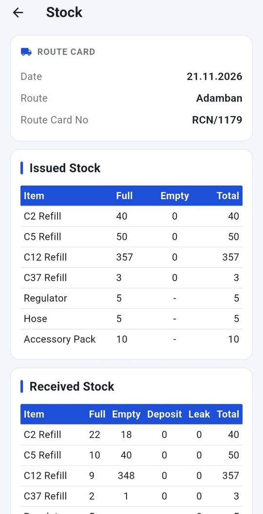
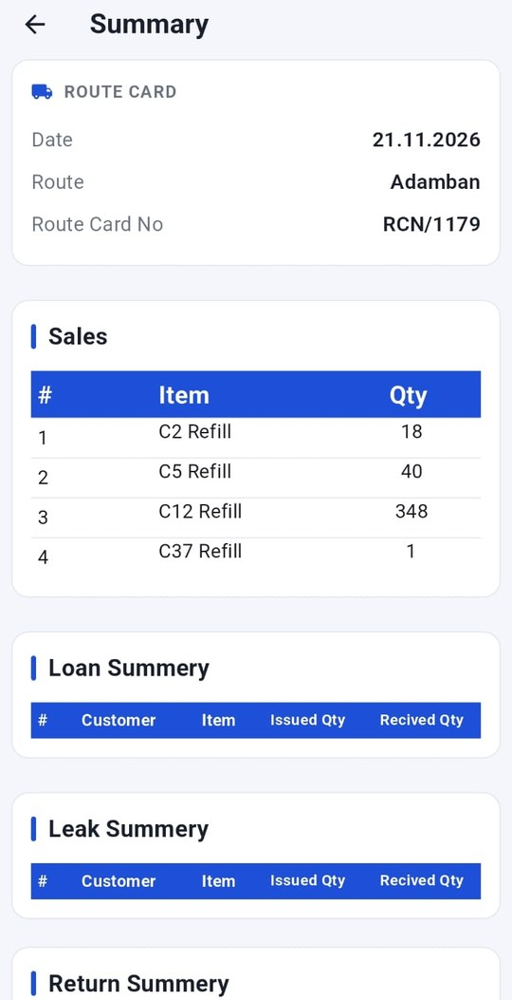

# 📱 Gas Billing App: Mobile Billing for Gas Distribution

A Flutter mobile app that sales reps use on the road to bill customers, manage cylinder stock and close out daily **route cards** for a **Litro Gas distributor in Sri Lanka**. It works together with the [LitroERP web system](https://github.com/Tharaka901/LitroERP-Showcase).

> 🔒 **This is a client project, so the source code is private.**
> This repository showcases the app's features and screenshots.
> I'm happy to walk through the app and the code in an interview.

---

## 📸 Preview

  
  
  

---

## ✨ Features

### 🗺 Route Cards
- View **pending** and **completed** route cards for the logged-in sales rep
- Every route card shows its date, route and route card number, with an acceptance status
- See **issued vs received stock** for each route (full, empty, deposit and leak cylinders)
- End-of-day **route summary** covering sales, loans, leaks and returns

### 🧾 Billing
- Find customers by **name search or QR code scan**
- Add items quickly with +/− quantity controls (refills, new cylinders and other items)
- Automatic invoice with unit prices, sub total, **18% VAT** and grand total
- Take payment by **cash, cheque or voucher**, or a mix of them, and issue a receipt
- **Print or share** a VAT invoice (A4) straight from the phone
- **Manual billing** and **gas meter billing**
- View **previous invoices**

### 🔄 Cylinder & Stock Operations
- **Loan** cylinders to customers and track them
- **Return cylinders** and record **leak** cylinders
- **Stock transfer** between routes
- **Collection summary** of cash collected on the route

### 🔐 Account
- Login with phone number and password
- Change password

---

## 🛠 Tech Stack

| Layer | Technology |
|---|---|
| Mobile app | Flutter (Dart) |
| Backend API | Node.js |
| Related system | [LitroERP web system](https://github.com/Tharaka901/LitroERP-Showcase) (Laravel) |

---

## 🖼 Screenshots

| Login | Home | Route Card |
|:---:|:---:|:---:|
|  |  |  |

| Select Customer (Search / QR) | Add Items | Invoice |
|:---:|:---:|:---:|
|  |  |  |

| Payment | Printed Invoice | Route Stock |
|:---:|:---:|:---:|
|  |  |  |

| Route Summary |
|:---:|
|  |

> Screenshots are taken with test data. Personal and business details are blurred.

---

## 🎥 Demo Video

<!-- Drag your MP4 into the GitHub editor here, or paste an unlisted YouTube link -->
_Coming soon_

---

## 👨‍💻 Developer

**Tharaka Gunasinghe**, Full-stack Developer
[GitHub](https://github.com/Tharaka901) · [LinkedIn](https://linkedin.com/in/YOUR-LINKEDIN) · [Email](mailto:YOUR.EMAIL@example.com)
